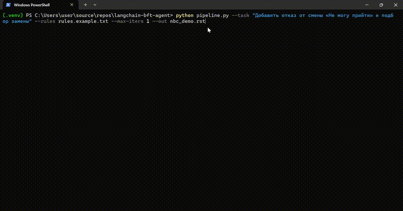

# 🤖 Многоагентный конвейер генерации БФТ по корпоративному стандарту

**LangChain + LangGraph + DeepSeek** · генератор → тестировщик → критик, с циклом «черновик → самопроверка → рецензия → исправление».

> **Суть:** я не «попросил LLM написать документ», а **формализовал методику системного аналитика в машинно-проверяемые правила** и построил конвейер, где модель **сама** пишет БФТ, **сама** проверяет структуру и **сама** рецензирует содержание.

---

## Зачем это нужно (связь с реальной работой)

Каждый аналитик сталкивается с двумя проблемами:

1. **Рутина** — подготовка БФТ, HLD, SRS отнимает часы.
2. **Контроль качества** — легко пропустить противоречие, забыть раздел, нарушить границу БФТ/HLD.

Конвейер решает обе: автоматизирует **черновик** и встраивает **проверку** (12 детерминированных правил + 23 правила критика), чтобы аналитик тратил время на смысл, а не на рутину.

---

## Что это делает

По описанию функции (например, *«добавить отказ от смены „Не могу прийти“ и подбор замены»*) конвейер готовит **БФТ** для приложения церкви в корпоративном Sphinx-стиле:

- глоссарий, сценарии использования с UML, ФТ/НФТ, отчётность;
- приложения: User Stories (Gherkin), AS-IS/TO-BE (BPMN), OpenAPI, C4.

Документ проходит **двойной контроль**: детерминированная проверка структуры (12 правил) и содержательная рецензия LLM-критика (23 правила, задаваемые свободным текстом).

---

## Какие навыки аналитика это показывает

| Навык | Где отражён |
|---|---|
| **Формализация методологии** | «Памятка аналитика» → 12 детерминированных правил (`tools.py`) + 23 правила критика (`rules.example.txt`) |
| **Многоагентная архитектура** | Роли генератор / тестировщик / критик — как разделение работы аналитика, ревьюера и инженера по качеству |
| **Граница БФТ / HLD** | Основной текст — «что», технические артефакты (OpenAPI, C4, BPMN) — в «Приложения» |
| **Контроль качества** | Цикл «черновик → проверка → рецензия → исправление» вместо единичной генерации «на веру» |
| **Владение LLM-инструментами** | LangGraph (StateGraph), LangChain, DeepSeek, Pydantic-схемы рецензии |

---

## Как это устроено

```
описание функции + правила критика
        │
        ▼
   ┌─────────────┐
   │  GENERATOR  │  LLM пишет черновик БФТ (по памятке и замечаниям рецензента)
   └──────┬──────┘
          ▼
   ┌─────────────┐
   │   TESTER    │  детерминированная проверка 12 правил структуры (validate_bfr)
   └──────┬──────┘
          ▼
   ┌─────────────┐
   │   CRITIC    │  LLM-рецензент: оценивает содержание по ВАШИМ правилам,
   │             │  отдаёт JSON {approved, issues:[{criterion, severity, problem, suggestion}]}
   └──────┬──────┘
          │ есть замечания? ──► обратно в GENERATOR (до N итераций)
          ▼
      готовый документ + рецензия
```

**Два столпа качества:**

1. **Тестировщик (детерминированный)** — проверяет *форму*: структуру, RST, глоссарий, якоря, терминологию. Чистые функции на регулярных выражениях, без модели.
2. **Критик (LLM)** — проверяет *содержание*: полноту, однозначность, измеримость требований, покрытие ролей, противоречия, границу БФТ/HLD.

---

## Пример сгенерированного документа

Фрагмент реального вывода (полный документ — с якорями, UML, User Stories и приложениями):

```rst
.. _terms:

Термины и определения
#####################

.. glossary::

   :График: план служений и смен церкви на определённый период
   :Смена: период служения, закреплённый за Участником в рамках графика
   :Участник: пользователь Приложения, включённый в график служений
   :Ответственный: участник, которому Координатор делегировал управление служением
```

---

## Демо



**Полное видео с паузой:** [demo.mp4](docs/demo.mp4)

```bash
python pipeline.py --task "Добавить отказ от смены «Не могу прийти» и подбор замены" --rules rules.example.txt
```

Реальные выкладки агентов: [черновик генератора](docs/demo_generator.rst) · [отчёт тестировщика](docs/demo_tester.txt) · [рецензия критика](docs/demo_critic.json).

---

## Технологии

| Слой | Инструменты |
|---|---|
| Оркестрация | LangGraph (StateGraph), LangChain |
| LLM | DeepSeek (можно заменить на GigaChat, YandexGPT, OpenAI) |
| Схемы рецензии | Pydantic |
| Формат документов | Sphinx / reStructuredText |
| Валидация структуры | собственные правила на регулярных выражениях |

---

## Запуск

```bash
# 1. Окружение
python -m venv .venv
.venv\Scripts\activate
pip install -r requirements.txt   # в сетях без доступа к pypi.org: -i https://mirrors.aliyun.com/pypi/simple/

# 2. Ключ (DS_API_KEY / DS_KEY / DEEPSEEK_API_KEY / OPENAI_API_KEY)
copy .env.example .env

# 3. Офлайн-проверка правил (без сети и ключа)
python smoke_test.py

# 4. Полный конвейер
python pipeline.py --task "Добавить отказ от смены «Не могу прийти» и подбор замены" --rules rules.example.txt
```

---

## Ограничения (честно)

- Правила проверяют **форму и структуру**, а не бизнес-логику — окончательную экспертизу делает аналитик.
- Агент не ищет информацию в интернете: данные берутся из задачи, памятки и правил критика.
- Качество зависит от модели; цикл самопроверки снижает, но не исключает ошибки.

---

## Лицензия

MIT License
